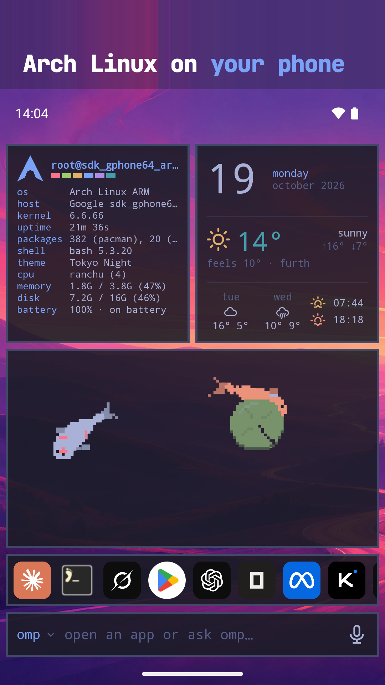
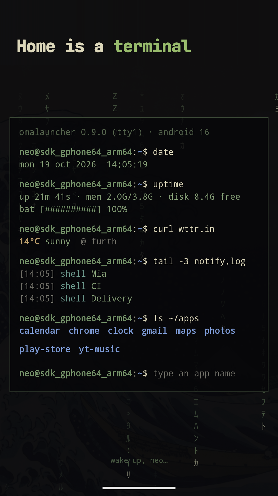
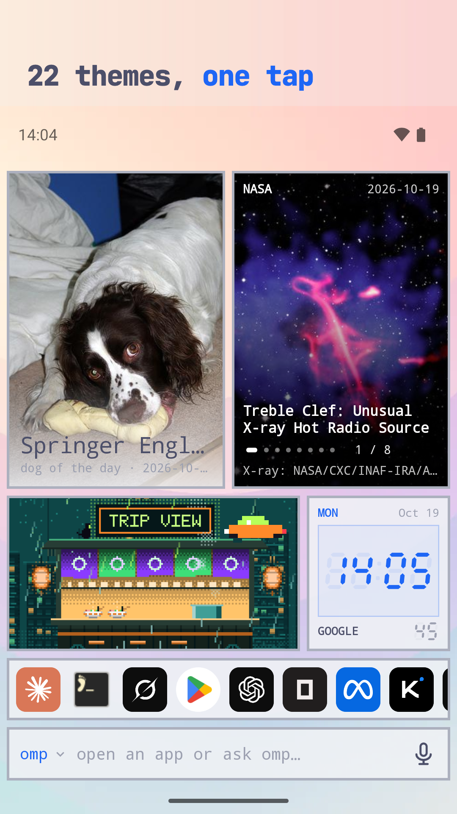
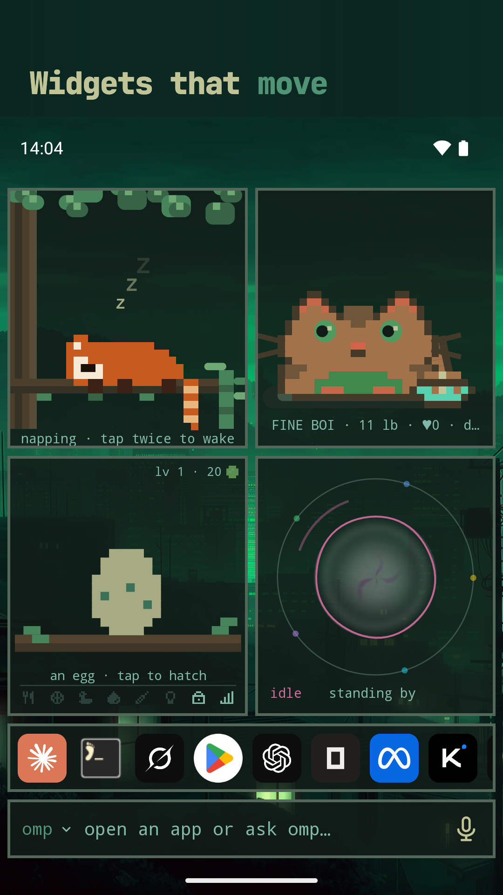

# Omalauncher

An Android home screen with the look of [Omarchy](https://omarchy.org), and an
optional Arch Linux ARM system next to your phone apps. Omalauncher runs the
system under proot, without root, and is its Wayland compositor: every Linux
window opens as its own Android task, with its own card in Recents.


<p>
  
  
  
  
</p>

<a href="https://play.google.com/store/apps/details?id=dev.omalauncher">Get it on Google Play</a>

- **Themes**: all 22 Omarchy themes, with their wallpapers, applied to the
  launcher and to the Linux apps, plus the community themes from
  [omarchy.org/themes](https://omarchy.org/themes/), or your own in
  `~/.config/omarchy/themes`
- **Widgets** written in OWL, a small declarative language you can edit on the
  phone, plus a [widget store](https://github.com/SimonSchubert/omarchy-widgets)
- **Linux, optional**: pacman and the AUR, Linux apps in their own windows,
  terminal widgets, a file manager, and opt-in GPU acceleration on Mali GPUs
- **Coding agents**: the bar at the bottom sends a prompt to Claude Code, Codex,
  Copilot, opencode and others, which open in a terminal
- No account, no ads, no tracking

Needs an arm64 phone with Android 10 or newer. Without Linux, the launcher still
has the themes, wallpapers, Android apps and the widgets that don't run commands.

## Using it

The bar: the one input at the bottom of the home screen opens apps and asks
coding agents. Focusing it opens the list of Linux and Android apps; typing
narrows the list, and Enter opens the highlighted app or sends the text to the
agent. Short queries that name an app open it, sentences go to the agent; Tab
and the arrow keys move the highlight. Tap the agent's name to pick another
installed one; the choice is saved in `~/.config/omalauncher/agent`. Hold the mic to talk and release to send, or tap it to dictate
into the field. Speech is recognized by Android (on the device when the phone
supports it), so only text reaches Linux.

For realtime voice in Linux apps, use **share phone mic** at the bottom-left of
a Linux window, or in the launcher's settings, and grant Android microphone
permission. This exposes the phone's raw audio as PulseAudio's default input,
`android_mic`; it is separate from the prompt bar's speech-to-text dictation.
The control shows **mic on · stop** while sharing. Sharing stops when all
launcher screens are hidden or Linux is removed, and must be enabled again.
Any Linux app recording that source can receive the audio and send it to its
own service. For Tern Carly, sign OMP in to ChatGPT (Codex), then turn on
Carly's microphone; her GPT realtime voice uses this input and the existing
Android speaker output.

Touch input in Linux windows: tap is a left click, long press is a right
click, drag scrolls; apps with touch support (foot, GTK) get real touch.
Hardware keyboard shortcuts: Super+Enter (terminal), Super+Space or
Super+A (the bar), Super+1..9 (home pages) on the home screen; Super+Enter
and Super+W (close) in Linux windows.

Tern in this phone's local install uses `~/.local/bin/tern`, including from its
desktop entries. The wrapper preloads
`~/.local/opt/tern-0.7.3/tern/proot-peercred.so`: PRoot otherwise exposes Android
user IDs between separate launcher processes but guest IDs within one process
tree, so Tern rejects its own daemon connection as an older daemon. The shim
maps only this Android user's credentials to the guest identity; other users
remain subject to Tern's normal access check, and pane shells stay root.
Its source is `proot-peercred.c` beside the library. Rebuild with
`cc -shared -fPIC -O2 -Wall -Wextra -Werror -Wl,-z,relro,-z,now -o proot-peercred.so.new proot-peercred.c`,
then atomically rename the new library over the old one and restart Tern's
daemon after saving work. Do not overwrite a library mapped by running processes.

### Local phone: Linux sessions disappearing together

If Tern, its daemon, and shell/agent processes disappear together, check Android
logcat before treating later GPU errors as the cause. On this phone, Android
logged `Trimming phantom processes` for Omalauncher's `libproot.so`; its Linux
children then died while the Android launcher process remained alive. The
default phantom-child limit was 32. Tern's GPU/Wayland errors followed the kill.

The live device fix is:

```sh
adb shell settings put global settings_enable_monitor_phantom_procs false
adb shell settings get global settings_enable_monitor_phantom_procs
# Expected: false
```

This is device-wide: it disables phantom-child trimming, not normal low-memory
kills. Android's framework checks this nonempty global setting before the
`persist.sys.fflag.override.settings_enable_monitor_phantom_procs` property;
changing that property is not required. No APK replacement or session restart
is needed. To restore this phone's previous unset value:
`adb shell settings delete global settings_enable_monitor_phantom_procs`.

A 35-second live check kept 40 temporary idle Linux children alive, preserved
the launcher and both Tern PIDs, and confirmed daemon/UI responses with no new
phantom-trim kills. This does not rule out unrelated future crashes or OOM kills.
The experimental ADB phone-gesture helper was removed: passive monitoring cannot
safely cancel the hardware touch stream or prove the target Tern window. The
native gesture fix is in `~/workspace/omalauncher-tern-gestures` on
`fix/tern-touch-keyboard` ([PR #128](https://github.com/SimonSchubert/omalauncher/pull/128)).
The Play-signed app remains unchanged; activation needs an official signed update.

### Local phone: reopening Tern from the work widget

`~/.config/omalauncher/widgets/30-tern.owl` uses `~/.local/bin/tern-widget`.
The dashboard's **open existing windows** buttons focus the actual Android
task, rather than merely changing a tab inside a hidden Tern window. The
helper discovers current task IDs; it does not assume that Android window
numbers match Tern daemon window keys. **select tab** targets the pane's
daemon group; then use the appropriate window's **open** button.

Window activation uses the phone's existing, authorized wireless ADB
connection. It needs exactly one connected device and reports a visible error
if that connection is unavailable or a listed task has closed. It does not
start OMP, replay prompts, or substitute a new session for a stale task.
The dashboard discovers live pane window keys instead of listing only the
widget shell's default window. Starting Tern or opening a new directory uses
the launcher's graphical `app(...)` action, not its bounded background shell.

This is a recovery control, not a fix for crashes or Android task retention.
Unlocking the phone is still required before interacting with its windows.

## Building

```sh
./scripts/fetch-proot.sh          # Termux's proot -> app/src/main/jniLibs (needs bsdtar)
./gradlew :app:installDebug
# optional: skip the 830 MB download on the device
adb push ArchLinuxARM-aarch64-latest.tar.gz /sdcard/Android/data/dev.omalauncher/files/
```

Tests: `./gradlew :owl:test :app:testDebugUnitTest`. `./gradlew :owl:owlJar`
builds `owl/build/cli/owl.jar`, the checker the widget store's CI runs.

In debug builds you can launch guest commands with
`adb shell am start -n dev.omalauncher/.MainActivity --es exec foot`.

- [docs/ARCHITECTURE.md](docs/ARCHITECTURE.md): the compositor, rendering, GPU
  acceleration, and how updates reach existing installs
- [docs/RELEASING.md](docs/RELEASING.md): Play releases and store assets
- [app/src/main/assets/widgets/README.md](app/src/main/assets/widgets/README.md):
  the widget language

## Layout

- `app/`: the Android app (Kotlin, Jetpack Compose, and the JNI bridge in `src/main/cpp`)
- `owl/`: the widget language and the `owl` command line, plain Kotlin
- `art/`: SVG masters for the app, agent and store icons
- `store/`: Play listing sources (screenshot frames, privacy policy)
- `fastlane/`: the Play listing and the upload lanes
- `scripts/`: fetching proot and theme colors, rendering icons, screenshots and widget previews

## License

MIT, see [LICENSE](LICENSE), for Omalauncher's own code and artwork. The
coding agents' logos, the symbol font and Omarchy's theme colors are not
covered; [THIRD_PARTY.md](THIRD_PARTY.md) lists them with their sources and
licenses. The app also ships proot, talloc and libandroid-shmem (GPL-2.0,
LGPL-3.0 and BSD-3-Clause, prebuilt by Termux), listed in the app under
settings › licenses.

Omalauncher is an independent project and is not affiliated with or endorsed
by Omarchy, Arch Linux, or the makers of the coding agents it installs.
